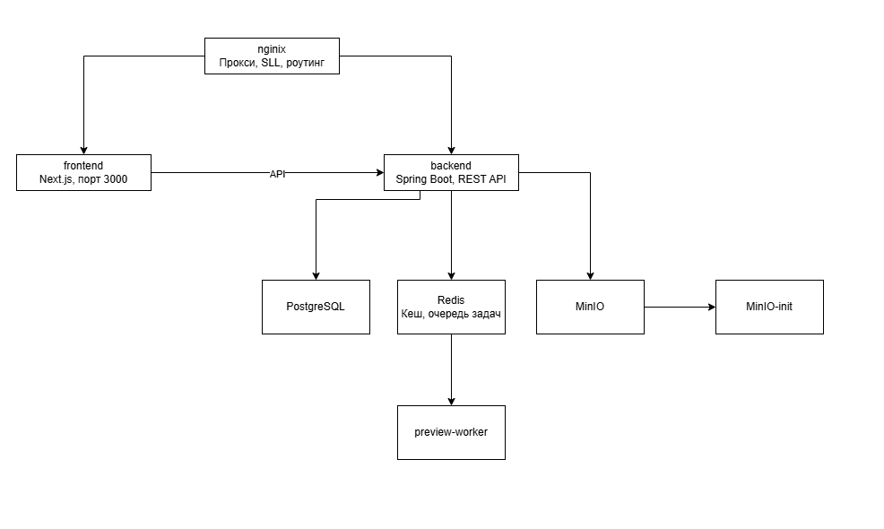
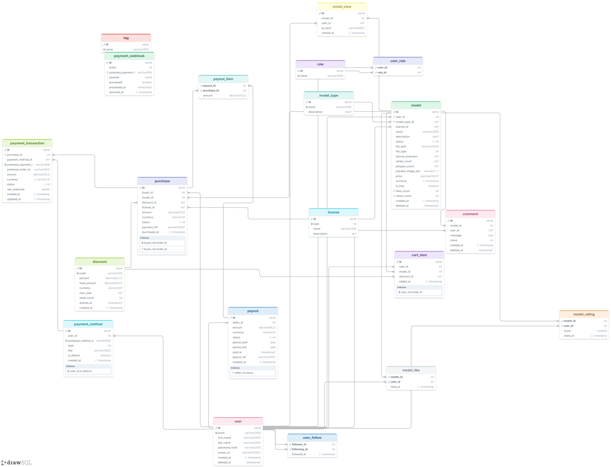
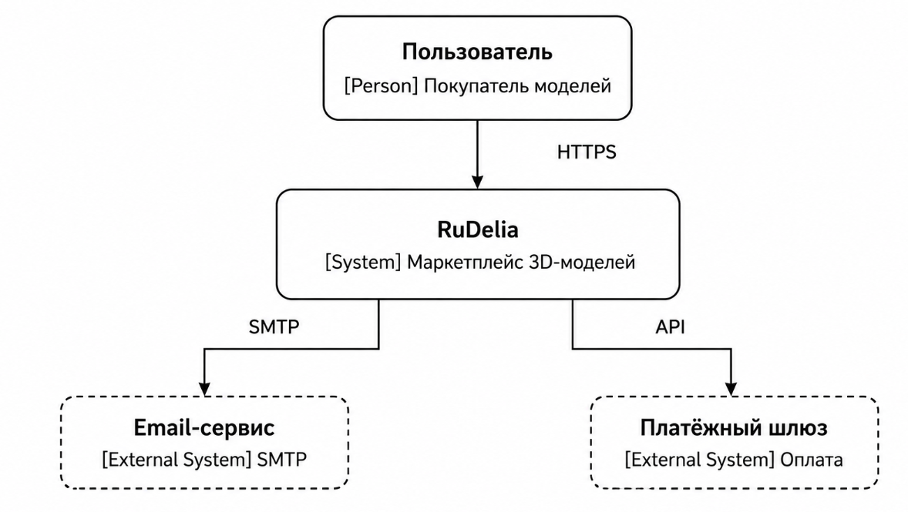
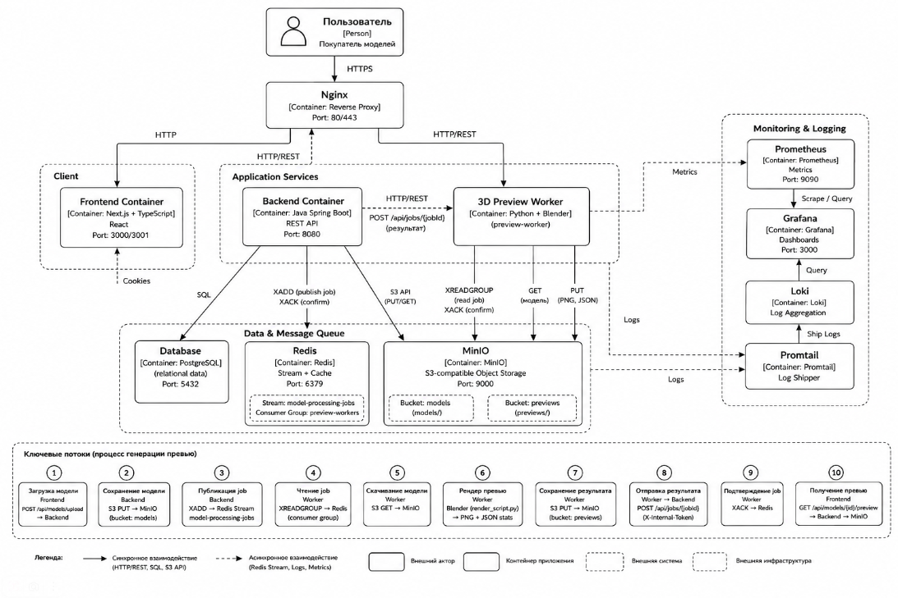

[//]: # (ОГЛАВЛЕНИЕ )

### ВВЕДЕНИЕ

Развитие рынка цифровых 3D__моделей и услуг 3D__печати формирует спрос на специализированные торговые площадки,
объединяющие каталог моделей, инструменты предпросмотра и логистику печати и доставки готовых изделий. Существующие
зарубежные платформы ориентированы преимущественно на англоязычную аудиторию и не учитывают особенности российского
рынка печати и доставки, что делает актуальной разработку отечественного решения.

Целью практики является разработка веб__платформы RuDelia — торговой площадки 3D__моделей с функцией печати и доставки,
реализованной с использованием современного стека веб__технологий. В ходе практики выполнены проектирование архитектуры
системы, разработка серверной и клиентской частей приложения, настройка инфраструктуры развёртывания и системы
мониторинга.

Результатом работы является функционирующий прототип платформы, развёрнутый на собственном сервере, включающий каталог
моделей, систему трёхмерного предпросмотра, серверную обработку заказов и асинхронный конвейер генерации превью моделей.

[//]: ### (1. Постановка задачи. Краткое описание предметной области.){
В рамках практики поставлена задача разработки веб__приложения RuDelia — маркетплейса 3D__моделей, предоставляющего
пользователям возможность просматривать каталог моделей, оформлять заказы на печать и доставку готовых изделий.

Приложение должно решать следующие задачи:

-предоставление каталога 3D__моделей с фильтрацией, сортировкой и поиском;

- интерактивный трёхмерный просмотр моделей непосредственно в браузере;

- автоматическая генерация превью__изображений для загружаемых моделей;

- оформление и обработка заказов на печать и доставку;

- разграничение доступа и профили пользователей.

Предметной областью является процесс размещения, просмотра и заказа цифровых 3D__моделей с последующей физической
печатью
изделия. Ключевыми сущностями предметной области выступают модель, пользователь, заказ и адрес доставки. Объектом
автоматизации является цикл от публикации модели в каталоге до формирования заказа на печать.

Особенностью проекта является распределённая архитектура: серверная часть построена на __Spring Boot__, клиентская — на
__Next.js__ с использованием App Router, а генерация трёхмерных превью вынесена в отдельный асинхронный сервис на _
_Python__
с использованием __Blender__.
}

[//]: ### (2. Разработка моделей бизнес__процессов предметной области.){
Основной бизнес__процесс платформы включает следующие этапы: пользователь просматривает каталог моделей, применяет
фильтры и сортировку, открывает карточку модели с интерактивным предпросмотром, добавляет модель к заказу, указывает
адрес доставки и подтверждает заказ.

Параллельным бизнес__процессом является публикация модели в каталог: файл модели загружается в объектное хранилище
__MinIO__, после чего задача на генерацию превью помещается в поток __Redis Stream__. Обработчик на базе __Python__ и
__Blender__ рендерит изображение модели и возвращает результат через REST__обратный вызов, после чего модель становится
доступной в каталоге.

}

[//]: ### (3. Построение функциональной модели информационной системы.){
Функциональная модель системы описывает основные варианты использования, доступные пользователю платформы. К ним
относятся: просмотр каталога, поиск и фильтрация моделей, интерактивный просмотр модели, регистрация и аутентификация,
оформление заказа, просмотр истории заказов и управление профилем.

Актором системы выступает зарегистрированный либо анонимный пользователь. Анонимному пользователю доступны просмотр
каталога и предпросмотр моделей, тогда как оформление заказа требует предварительной аутентификации, что реализовано
через проверку сессии на уровне __Spring Security__.
}

[//]: ### (4. Разработка объектно__ориентированной модели прикладных объектов.){
Объектно__ориентированная модель системы построена на основе диаграммы классов предметной области. Ключевыми классами
являются __Model__ (3D__модель с атрибутами названия, файла, статуса превью), __User__ (профиль пользователя), __Order
__ (
заказ), __ShippingAddress__ (адрес доставки) и __OrderItem__ (позиция заказа, связывающая модель и заказ).

Класс __Model__ связан отношением "один ко многим" с классом __OrderItem__, а класс __Order__ агрегирует несколько _
_OrderItem__
и ссылается на один объект __ShippingAddress__. Такая структура позволяет хранить историю заказов независимо от
последующих изменений адресных данных пользователя.
}

[//]: ### (5. Программная реализация информационной системы.){
Программная реализация платформы RuDelia выполнена в виде набора взаимодействующих сервисов, оркестрируемых с помощью
__Docker Compose__ на собственном сервере. Взаимодействие внешних клиентов с системой проходит через обратный прокси
__nginx__, обеспечивающий терминацию __SSL__.
}

#### 5.1 Разработка серверной части

Серверная часть реализована на __Spring Boot__ и предоставляет __REST API__ для клиентского приложения. Хранение
реляционных
данных осуществляется в __PostgreSQL__, а кэширование и работа с очередями сообщений — в __Redis__. Файлы моделей и
сгенерированные изображения превью хранятся в объектном хранилище __MinIO__.

Обработка запроса на генерацию превью реализована асинхронно: сервер публикует задачу в __Redis Stream__, которую
забирает
независимый обработчик __worker.py__, использующий __Blender__ в headless__режиме для рендеринга изображения модели,
после
чего результат возвращается серверу через __REST__ обратный вызов.

В ходе разработки решён ряд проблем промышленной эксплуатации, в том числе исключение __READONLY__ при подключении
клиента
__Lettuce__ к реплике __Redis__, а также некорректная сериализация значения __Promise__ в заголовке __Cookie__.

#### 5.2 Разработка клиентской части

Клиентская часть построена на __Next.js__ с использованием __App Router__ и включает компоненты каталога моделей,
карточки
модели, панели фильтрации и поиска, а также элементы навигации, адаптированные под мобильные устройства.

Для интерактивного трёхмерного просмотра моделей применяется библиотека __three.js__ совместно с __OrbitControls__ и
__GLTFLoader__; при отсутствии загруженной модели отображается заглушка в виде каркасного куба. Состояние фильтров,
сортировки и поисковой строки синхронизировано с параметрами __URL__ через хук __useSearchParams__, что обеспечивает
сохранение состояния при обновлении страницы.

Оформление интерфейса поддерживает светлую и тёмную темы на основе __CSS custom properties__ и атрибута __data__theme__,
переключаемых через компонент __ThemeProvider__ со скриптом предотвращения визуального мерцания при загрузке страницы.

#### 5.3 Настройка инфраструктуры развёртывания и мониторинга

Инфраструктура платформы RuDelia описана декларативно с помощью __Docker Compose__ и развёрнута на собственном сервере
без
использования внешних облачных провайдеров. Основной файл __docker__compose.yml__ подключает отдельный файл мониторинга
через директиву __include__, что позволяет разделить конфигурацию прикладных сервисов и конфигурацию наблюдаемости
системы.

Архитектура состоит из семи взаимодействующих контейнеров, объединённых общей сетью __Docker__: обратный прокси __nginx
__,
клиентское приложение __frontend__ на __Next.js__, серверное приложение __backend__ на __Spring Boot__, реляционная база
данных
__PostgreSQL__ (контейнер __modelsDB__), кэш и брокер сообщений __Redis__, объектное хранилище __MinIO__ и
вспомогательный
контейнер __minio__init__, выполняющий одноразовую инициализацию бакета при первом запуске.



Внешний трафик по портам 80 и 443 принимается контейнером __nginx__, который выполняет терминацию __SSL__ с
использованием
сертификатов __Let's Encrypt__, смонтированных в режиме только для чтения из каталога __/etc/letsencrypt__
хост__системы.
Далее __nginx__ маршрутизирует запросы: статические и клиентские запросы — на внутренний порт 3000 контейнера __frontend
__,
запросы к __REST API__ — на порт 8080 контейнера __backend__ (__app__). Оба целевых контейнера не публикуют порты наружу
напрямую, а объявлены через директиву __expose__, что ограничивает доступ к ним только внутренней сетью __Docker__ и
снижает
поверхность атаки.

Контейнер __backend__ взаимодействует с тремя инфраструктурными сервисами: с __PostgreSQL__ — для хранения реляционных
данных (каталог моделей, пользователи, заказы), с __Redis__ — для кэширования и работы очереди задач на генерацию превью
через __Redis Stream__, и с __MinIO__ — для хранения файлов моделей и превью__изображений по протоколу, совместимому с _
_S3__.
Параметры подключения к каждому из сервисов передаются контейнеру через переменные окружения (__POSTGRES_DB__,
__POSTGRES_USER__, __POSTGRES_PASSWORD__, __MINIO_URL__, __MINIO_BUCKET__ и другие), значения которых подставляются из
__.env__файла на этапе запуска __Docker Compose__.

Инициализация схемы базы данных выполняется автоматически: файл __init.sql__ монтируется в служебный каталог
__/docker__entrypoint__initdb.d__ образа __PostgreSQL__ и выполняется при первом старте контейнера. Готовность базы
данных к
приёму подключений проверяется встроенным __healthcheck__ на основе команды __pg_isready__ с интервалом опроса 5 секунд.

Контейнер __minio__init__, построенный на образе клиента __minio/mc__, запускается после __minio__ и в цикле ожидает
готовности
хранилища, после чего создаёт рабочий бакет командой __mc mb ____ignore__existing__, что делает инициализацию
идемпотентной
при повторных запусках развёртывания.

В конфигурации предусмотрены, но временно отключены (закомментированы) сервисы __preview__service__ и __preview__worker
__,
реализующие асинхронный конвейер рендеринга трёхмерного превью на базе __Blender__ в headless__режиме. Согласно
конфигурации, __preview__worker__ подписан на поток __Redis Stream__ с именем __model__processing__jobs__ в составе
группы
потребителей __preview__workers__ и по завершении обработки обращается к __backend__ по внутреннему
адресу __http://backend:8080__ для передачи результата. Отключение этих сервисов в текущей версии файла означает, что
соответствующий обработчик запускается отдельно от основного стека __Docker Compose__, либо находится на этапе
доработки.

Персистентность данных обеспечивается именованными томами __Docker__: __pg_data__ — для файлов базы данных __PostgreSQL
__,
__redis_data__ — для журнала операций __Redis__ в режиме __appendonly__, __minio_data__ — для объектов, хранимых в _
_MinIO__.
Использование именованных томов позволяет сохранять данные при пересоздании контейнеров в процессе обновления образов.

Таблица 2 — Сервисы docker__compose и их назначение.

| Сервис     | Образ / сборка     | Назначение                                     | Порты         |
|------------|--------------------|------------------------------------------------|---------------|
| nginx      | nginx:alpine       | Обратный прокси, терминация -SSL-              | 80, 443       |
| frontend   | сборка ../frontend | Клиентское приложение -Next.js-                | 3000 (внутр.) |
| backend    | сборка ../backend  | Серверное приложение -Spring Boot-, -REST API- | 8080          |
| postgres   | postgres           | Реляционная база данных                        | внутр.        |
| redis      | redis:8-alpine     | Кэш и очередь сообщений                        | 6379          |
| minio      | minio/minio        | Объектное хранилище файлов и превью            | 9000, 9001    |
| minio-init | minio/mc           | Одноразовая инициализация бакета               | —             |

Для непрерывной доставки изменений конфигурация развёртывания интегрирована с конвейером __CI/CD__ на базе __GitHub
Actions__: после сборки образов выполняется прямое развёртывание по протоколу __SSH__ на сервер без промежуточного
реестра образов, что упрощает инфраструктуру ценой отсутствия версионирования собранных образов вне сервера.

Наблюдаемость системы вынесена в отдельный файл __docker-compose.monitoring.yml__, подключаемый через __include__, и
включает стек __Grafana__, __Prometheus__, __Loki__ и __Promtail__. __Prometheus__ собирает метрики хост-системы через _
_node_exporter__ и метрики приложения через встроенный эндпоинт __Spring Boot Actuator__, __Promtail__ агрегирует логи
контейнеров и передаёт их в __Loki__, а __Grafana__ предоставляет единый интерфейс для визуализации метрик и логов.

В процессе эксплуатации данной инфраструктуры были выявлены и устранены две существенные проблемы. Во-первых, авария,
вызванная несовместимостью процессора сервера с набором инструкций __x86-64-v2__, приводившая к аварийному завершению
контейнеров __frontend__ и __minio__ с кодом ошибки 132 (__SIGILL__). Во-вторых, эффект закольцованной маршрутизации (_
_NAT hairpin__), возникавший при обращении внутренних сервисов к внешнему доменному имени платформы, — проблема
устранена настройкой локального __DNS__ на базе __AdGuard Home__ с правилами подмены записей, направляющими внутренний
трафик напрямую на контейнер __nginx__, минуя внешний маршрутизатор.

[//]: ### (6. Структура таблицы model в базе данных.){
Центральной таблицей базы данных платформы RuDelia является таблица -model-, хранящая сведения о загруженных 3D-моделях.
Таблица создаётся оператором -CREATE TABLE public.model- и содержит следующие поля. Диаграмма представлена на рисунке 5.


Таблица 1 — Структура таблицы model

| Поле               | Тип данных    | Назначение                                                  |
|--------------------|---------------|-------------------------------------------------------------|
| id                 | bigint        | первичный ключ, уникальный идентификатор модели             |
| user_id            | integer       | внешний ключ на таблицу users, идентификатор автора модели  |
| model_type_id      | integer       | внешний ключ на таблицу model_type, категория модели        |
| license_id         | integer       | внешний ключ на таблицу license, тип лицензии использования |
| name               | varchar(255)  | название модели                                             |
| description        | text          | текстовое описание модели                                   |
| status             | integer       | статус модели (модерация, публикация, скрытие)              |
| file_path          | varchar(1024) | путь к файлу модели в объектном хранилище                   |
| file_type          | integer       | код формата файла модели                                    |
| texture_extension  | integer       | код формата файла текстуры                                  |
| vertex_count       | integer       | количество вершин в геометрии модели                        |
| polygon_count      | integer       | количество полигонов в геометрии модели                     |
| preview_image_path | varchar(1024) | путь к сгенерированному изображению превью                  |
| price              | numeric(10,2) | стоимость модели                                            |
| currency           | varchar(3)    | код валюты стоимости                                        |
| is_free            | boolean       | признак бесплатного распространения модели                  |
| likes_count        | integer       | счётчик отметок «нравится»                                  |
| views_count        | integer       | счётчик просмотров карточки модели                          |
| created_at         | timestamp     | дата и время создания записи                                |
| deleted_at         | timestamp     | дата и время мягкого удаления записи                        |

Первичным ключом таблицы является поле __id__, значение которого генерируется последовательностью __model_id_seq__. Поля
__user_id__, __model_type_id__ и __license_id__ образуют внешние ключи, связывающие модель с автором, категорией и типом
лицензии соответственно, что соответствует диаграмме классов, рассмотренной в разделе 4.

Поля __vertex_count__ и __polygon_count__ сохраняются на этапе загрузки файла модели и используются интерфейсом каталога
для
отображения технической сложности изделия без необходимости повторного разбора файла. Поля __likes_count__ и _
_views_count__
денормализованы: их значения дублируют агрегаты из связанных таблиц __model_like__ и __model_view__ и обновляются
инкрементально, что позволяет избежать пересчёта агрегатов при каждом отображении карточки модели в каталоге.

Поле __deleted_at__ реализует механизм мягкого удаления: запись не удаляется физически, а помечается временем удаления,
что сохраняет ссылочную целостность для связанных записей в таблицах __purchase__, __comment__ и __cart_item__,
содержащих
исторические ссылки на модель.

Таблица __model__ является наиболее часто используемой в системе: на неё напрямую ссылаются таблицы __cart_item__,
__purchase__, __comment__, __model_like__, __model_rating__ и __model_view__, что отражает её роль центральной сущности
предметной
области.
}

Ниже — новые разделы 7–9 в том же синтаксисе отчёта, со ссылками на построенные диаграммы. По платёжному шлюзу: в бэкапе
БД есть таблицы `payment_transaction`, `payment_webhook`, `payment_method`, `payout` — на их основании я и обозначил
внешний платёжный шлюз на C4-диаграммах; если это не так (например, это заглушка на будущее), скажи — уберу.

[//]: ### (7. C4-модель архитектуры системы.){
Для описания архитектуры RuDelia на разных уровнях детализации применена нотация __C4 Model__, включающая уровни _
_Context__ и __Container__.



На уровне контекста система __RuDelia__ рассматривается как единый чёрный ящик, с которым взаимодействует пользователь
по протоколу __HTTPS__. Система в свою очередь обращается к двум внешним системам: __email-сервису__ по протоколу __SMTP
__ для отправки уведомлений и __платёжному шлюзу__ по __REST API__ для обработки транзакций, что подтверждается наличием
в базе данных таблиц __payment_transaction__, __payment_webhook__ и __payment_method__.



На уровне контейнеров система декомпозируется на __nginx__ (обратный прокси), __frontend__ (Next.js), __backend__ (
Spring Boot) и три инфраструктурных контейнера — __PostgreSQL__, __Redis__ и __MinIO__. Контейнер __backend__ является
единственной точкой интеграции с внешним платёжным шлюзом, что соответствует принципу изоляции внешних интеграций на
уровне серверной части, а не клиента.
}

[//]: ### (8. Архитектурные решения (ADR).){
В ходе разработки платформы RuDelia зафиксирован ряд ключевых архитектурных решений в формате __Architecture Decision
Record__.
}

#### 8.1 ADR-1. Асинхронная генерация превью через Redis Stream

Статус: принято.

Контекст: рендеринг превью 3D-модели средствами __Blender__ занимает продолжительное время и не может выполняться
синхронно в рамках HTTP-запроса на загрузку модели.

Решение: задача на генерацию превью публикуется в __Redis Stream__ и обрабатывается независимым воркером __worker.py__,
результат возвращается через __REST__-обратный вызов к __backend__.

Последствия: пользователь не блокируется на время рендеринга, однако появляется дополнительный отказоустойчивый
компонент и необходимость отслеживать статус обработки задачи (модель временно находится в статусе «на обработке»).

#### 8.2 ADR-2. Прямое SSH-развёртывание без реестра образов

Статус: принято.

Контекст: требовался простой конвейер __CI/CD__ без затрат на аренду или поддержку приватного реестра образов __Docker
__.

Решение: конвейер __GitHub Actions__ собирает образы и разворачивает их напрямую по __SSH__ на собственный сервер, минуя
промежуточный реестр.

Последствия: упрощение инфраструктуры и снижение затрат ценой отсутствия версионирования собранных образов вне сервера и
невозможности быстрого отката на образ из реестра без пересборки.

#### 8.3 ADR-3. Самостоятельно хостируемое объектное хранилище MinIO вместо облачного S3

Статус: принято.

Контекст: требовалось S3-совместимое хранилище для файлов моделей и превью-изображений без затрат на облачного
провайдера.

Решение: развёрнут __MinIO__ в контейнере __Docker__ на собственном сервере, с одноразовой инициализацией бакета через
контейнер __minio-init__.

Последствия: отсутствие затрат на внешнее хранилище и полный контроль над данными, но ответственность за резервное
копирование и отказоустойчивость хранилища полностью ложится на владельца сервера.

[//]: ### (9. Метрики и наблюдаемость системы.){
Сбор метрик реализован средствами __Prometheus__ через два источника: __node_exporter__ (метрики хост-системы) и
встроенный эндпоинт __Spring Boot Actuator__ (метрики приложения __backend__). Визуализация выполняется в __Grafana__,
логи агрегируются __Promtail__ и хранятся в __Loki__.


| Метрика                          | Источник             | Назначение                            |
|----------------------------------|----------------------|---------------------------------------|
| node_cpu_seconds_total           | node_exporter        | Загрузка процессора хост-сервера      |
| node_memory_MemAvailable_bytes   | node_exporter        | Доступная оперативная память          |
| node_filesystem_avail_bytes      | node_exporter        | Свободное место на диске              |
| node_network_receive_bytes_total | node_exporter        | Входящий сетевой трафик               |
| http_server_requests_seconds     | Spring Boot Actuator | Время обработки HTTP-запросов backend |
| jvm_memory_used_bytes            | Spring Boot Actuator | Использование памяти JVM              |
| hikaricp_connections_active      | Spring Boot Actuator | Активные соединения пула к PostgreSQL |
| process_uptime_seconds           | Spring Boot Actuator | Время работы backend без перезапуска  |

Совместное использование метрик хост-системы и метрик приложения позволяет отделять проблемы инфраструктуры (например,
нехватку памяти на сервере) от проблем на уровне приложения (например, деградации времени ответа __REST API__ при
неизменной загрузке процессора), что использовалось при диагностике аварии, связанной с несовместимостью процессора с
набором инструкций __x86-64-v2__, описанной в разделе 5.3.
}

### ЗАКЛЮЧЕНИЕ

В ходе практики разработан прототип веб-платформы RuDelia для размещения, просмотра и заказа печати 3D-моделей.
Реализована распределённая архитектура, включающая серверную часть на __Spring Boot__, клиентскую часть на __Next.js__,
асинхронный конвейер генерации превью на базе __Python__ и __Blender__, а также инфраструктуру хранения данных на _
_PostgreSQL__, __Redis__ и __MinIO__.

Настроено развёртывание системы через __Docker Compose__ с обратным прокси __nginx__ и автоматизированным конвейером _
_CI/CD__, а также стек мониторинга для наблюдения за состоянием сервисов. В процессе разработки решён ряд практических
задач промышленной эксплуатации, связанных с сетевой конфигурацией, отказоустойчивостью кэша и совместимостью аппаратной
платформы.

Поставленные задачи практики выполнены: разработан функционирующий прототип информационной системы, подготовлена
документация по его архитектуре и реализации.

[//]: ### (Литература ){

1. ГОСТ 7.32-2017. Отчет о научно-исследовательской работе (НИР). Структура и правила оформления. — Введ. 2018-07-01. —
   М.: Стандартинформ, 2018. — 36 с.

2. Fielding R., Reschke J. RFC 7231. Hypertext Transfer Protocol (HTTP/1.1): Semantics and Content. — Internet
   Engineering Task Force, 2014. — 100 p.

3. Ньюман С. Создание микросервисов / С. Ньюман; пер. с англ. — СПб.: Питер, 2016. — 304 с.

4. Next.js Documentation [Электронный ресурс]. — Vercel Inc. — Режим доступа: https://nextjs.org/docs (дата обращения:
   15.07.2026).

5. Spring Boot Reference Documentation [Электронный ресурс]. — VMware, Inc. — Режим
   доступа: https://docs.spring.io/spring-boot/docs/current/reference/html/ (дата обращения: 15.07.2026).

6. Docker Compose Documentation [Электронный ресурс]. — Docker Inc. — Режим доступа: https://docs.docker.com/compose/ (
   дата обращения: 15.07.2026).
   }

Стандарт [1] определяет структуру и правила оформления настоящего отчёта. Взаимодействие клиентской и серверной частей
построено на принципах, описанных в спецификации протокола передачи гипертекста [2]. Принципы декомпозиции
распределённой системы на независимые сервисы соответствуют подходу, изложенному в [3]. Структура клиентского приложения
основана на официальной документации используемого фреймворка [4], серверная часть реализована согласно
рекомендациям [5], а конфигурация инфраструктуры — согласно документации [6].

[//]: # ( Приложение А. Листинг программы){

### Листинг А.1. Обработчик генерации превью модели (worker.py — фрагмент)

```
import os
import json
import uuid
import asyncio
import logging
import tempfile
from pathlib import Path
from urllib.parse import urlparse

import httpx
import redis.asyncio as redis
from minio import Minio
from minio.error import S3Error

from preview_worker import render_preview, RenderError

logging.basicConfig(level=logging.INFO, format="%(asctime)s %(levelname)s %(message)s")
log = logging.getLogger("worker")

REDIS_HOST = os.getenv("REDIS_HOST", "redis")
REDIS_PORT = int(os.getenv("REDIS_PORT", "6379"))
STREAM_KEY = os.getenv("JOBS_STREAM", "model-processing-jobs")
GROUP_NAME = os.getenv("JOBS_GROUP", "preview-workers")
CONSUMER_NAME = os.getenv("HOSTNAME", f"worker-{uuid.uuid4().hex[:8]}")

SPRING_BASE_URL = os.getenv("SPRING_BASE_URL", "http://backend:8080")
INTERNAL_WORKER_TOKEN = os.environ["INTERNAL_WORKER_TOKEN"]

MINIO_URL = os.getenv("MINIO_URL", "http://minio:9000")
_parsed_minio = urlparse(MINIO_URL if "//" in MINIO_URL else f"//{MINIO_URL}")
MINIO_ENDPOINT = _parsed_minio.netloc or _parsed_minio.path
MINIO_SECURE = _parsed_minio.scheme == "https"
MINIO_ACCESS_KEY = os.getenv("MINIO_ROOT_USER")
MINIO_SECRET_KEY = os.getenv("MINIO_ROOT_PASSWORD")

PREVIEW_BUCKET = os.getenv("MINIO_BUCKET")
PREVIEW_PREFIX = os.getenv("PREVIEW_PREFIX", "previews")

RENDER_WIDTH = int(os.getenv("RENDER_WIDTH", "512"))
RENDER_HEIGHT = int(os.getenv("RENDER_HEIGHT", "512"))

TEMP_DIR = Path(tempfile.gettempdir()) / "preview_worker"
TEMP_DIR.mkdir(exist_ok=True)

minio_client = Minio(
    MINIO_ENDPOINT,
    access_key=MINIO_ACCESS_KEY,
    secret_key=MINIO_SECRET_KEY,
    secure=MINIO_SECURE,
)

http_client = httpx.AsyncClient(base_url=SPRING_BASE_URL, timeout=30.0)


def _get_request_headers():
    """Возвращает headers с токеном для безопасности."""
    return {"X-Internal-Token": INTERNAL_WORKER_TOKEN}


async def ensure_group(r: "redis.Redis"):
    try:
        await r.xgroup_create(STREAM_KEY, GROUP_NAME, id="0", mkstream=True)
        log.info("Создана группа %s на stream %s", GROUP_NAME, STREAM_KEY)
    except redis.ResponseError as e:
        if "BUSYGROUP" not in str(e):
            raise


async def set_status_processing(job_id: str):
    try:
        resp = await http_client.post(
            f"/api/jobs/{job_id}/status",
            json={"status": "PROCESSING"},
            headers=_get_request_headers(),
        )
        resp.raise_for_status()
    except Exception as e:

        log.warning("Не удалось выставить PROCESSING для job=%s: %s", job_id, e)


async def send_result(
    job_id: str,
    status: str,
    vertex_count: int = 0,
    polygon_count: int = 0,
    preview_image_path: str | None = None,
    error: str | None = None,
):
    payload = {
        "status": status,
        "vertexCount": vertex_count,
        "polygonCount": polygon_count,
        "previewImagePath": preview_image_path,
        "error": error,
    }
    try:
        resp = await http_client.post(
            f"/api/jobs/{job_id}",
            json=payload,
            headers=_get_request_headers(),
        )
        resp.raise_for_status()
    except Exception as e:
        log.error("Не удалось отправить результат job=%s: %s", job_id, e)


async def process_job(fields: dict):
    job_id = fields["jobId"]
    model_id = fields.get("modelId")
    model_file_id = fields.get("modelFileId")
    bucket = fields["bucket"]
    object_key = fields["objectKey"]

    log.info(
        "Обработка job=%s model=%s modelFile=%s key=%s/%s",
        job_id, model_id, model_file_id, bucket, object_key,
    )

    suffix = Path(object_key).suffix.lower() or ".glb"
    model_path = TEMP_DIR / f"{job_id}{suffix}"
    output_path = TEMP_DIR / f"{job_id}.png"

    await set_status_processing(job_id)

    try:
        minio_client.fget_object(bucket, object_key, str(model_path))

        stats = await render_preview(
            model_path, output_path, width=RENDER_WIDTH, height=RENDER_HEIGHT
        )

        preview_bucket = PREVIEW_BUCKET or bucket
        preview_key = f"{PREVIEW_PREFIX}/{job_id}.png"
        minio_client.fput_object(
            preview_bucket, preview_key, str(output_path), content_type="image/png"
        )

        await send_result(
            job_id,
            status="COMPLETED",
            vertex_count=stats["vertex_count"],
            polygon_count=stats["polygon_count"],
            preview_image_path=preview_key,
        )
        log.info("job=%s COMPLETED", job_id)

    except (RenderError, S3Error) as e:
        log.error("job=%s FAILED: %s", job_id, e)
        await send_result(job_id, status="FAILED", error=str(e))

    except Exception as e:
        log.exception("job=%s FAILED (неожиданная ошибка)", job_id)
        await send_result(job_id, status="FAILED", error=str(e))

    finally:
        model_path.unlink(missing_ok=True)
        output_path.unlink(missing_ok=True)


async def main():
    r = redis.Redis(host=REDIS_HOST, port=REDIS_PORT, decode_responses=True)
    await ensure_group(r)

    log.info(
        "Worker %s слушает stream=%s group=%s",
        CONSUMER_NAME, STREAM_KEY, GROUP_NAME,
    )

    while True:
        try:
            entries = await r.xreadgroup(
                GROUP_NAME, CONSUMER_NAME,
                {STREAM_KEY: ">"},
                count=1, block=5000,
            )
        except Exception as e:
            log.error("Ошибка чтения из Redis: %s", e)
            await asyncio.sleep(2)
            continue

        if not entries:
            continue

        for _stream_name, messages in entries:
            for msg_id, fields in messages:
                try:
                    await process_job(fields)
                except Exception:
                    log.exception("Необработанная ошибка при обработке %s", msg_id)
                finally:
                    await r.xack(STREAM_KEY, GROUP_NAME, msg_id)


if __name__ == "__main__":
    asyncio.run(main())
```

### Листинг А.2. Компонент карточки модели (client/components/ModelCard.tsx — фрагмент)

```
export function ModelCard({ model }: { model: Model }) {
  return (
    <div className={styles.card}>
      
      <h3>{model.title}</h3>
      <span>{model.price} ₽</span>
    </div>
  );
}
```
}